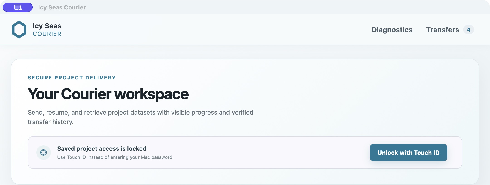
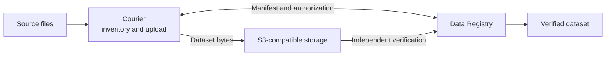

<p align="center">
  
</p>

<h1 align="center">Icy Seas Courier</h1>

<p align="center">
  Resumable scientific-data transfer, from the field to independently verified storage.
</p>

<p align="center">
  <a href="#quick-start">Quick start</a> ·
  <a href="#desktop-application">Desktop application</a> ·
  <a href="#data-registry">Data Registry</a> ·
  <a href="docs/architecture.md">Architecture</a>
</p>

Courier is a transfer client for Icy Seas Co-Laboratory LLC. A shared Rust engine powers its CLI and desktop interfaces, with headless and instrument-facing clients planned around the same implementation.



### From source files to verified datasets



- **Resume with confidence:** persistent local state, source-mutation checks, and multipart reconciliation support interrupted transfers.
- **Transfer directly:** dataset bytes travel to S3-compatible storage using short-lived Registry-issued URLs; the Registry does not proxy them.
- **Verify independently:** the Registry keeps logical files separate from transport objects and marks a transfer `complete` only after server-side verification.

The current client-first foundation includes deterministic packing, bounded-memory uploads, retry policy, immutable manifest v3, and scoped renewable sessions.

## Quick start

For a prepared live demonstration:

```bash
./scripts/demo-start.sh
```

The command starts the Registry and verification worker, creates representative synthetic data and a single-use invitation, prints the presenter flow, and launches the desktop client.

For the development CLI:

```bash
cargo run -p courier-cli -- upload ./test-data --project P26014
cargo run -p courier-cli -- transfers
cargo run -p courier-cli -- inspect <transfer-id>
```

For the local multipart proof of concept:

```bash
docker-compose up -d seaweedfs
export AWS_ACCESS_KEY_ID=development
export AWS_SECRET_ACCESS_KEY=development
export AWS_REGION=us-east-1
cargo run -p courier-cli -- send <transfer-id>
```

The development CLI uploads directly to its configured S3-compatible data plane and therefore stops at `finalizing`. The Registry-connected desktop flow submits the transfer for independent verification and polls until it reaches `complete` or `failed`.

For a headless machine, build the CLI with `cargo build --release -p courier-cli` and place `target/release/courier` on that machine's PATH. An administrator can open a completed transfer or project in the Registry console and copy its **Retrieve on another machine** command. The CLI asks for a project-scoped, read-only download invitation through a silent shell prompt. It downloads directly from the Registry-authorized S3 URLs, reconstructs packed files, verifies every logical file against the manifest, and publishes a new destination directory only after verification succeeds. The destination machine must reach both the Registry HTTPS address and the public S3 endpoint.

Use `--state-db ./courier.db` for an isolated development database and `--json` for automation.

## Development

```bash
cargo fmt --check
cargo clippy --workspace --all-targets -- -D warnings
cargo test --workspace
cargo test -p courier-transfer --test seaweedfs -- --ignored
```

See [docs/architecture.md](docs/architecture.md), [docs/adr](docs/adr), and the [closed-beta deployment runbook](docs/beta-deployment.md) for design and operating guidance.

## Desktop application

The initial Tauri 2/Svelte application lives in `apps/courier-desktop`. It provides validated Registry endpoint configuration, invitation context, native source-folder selection, Rust-backed inventory review, and locally persisted transfer discovery.

```bash
cd apps/courier-desktop
npm install
npm run check
npm run tauri dev
```

The desktop exchanges project-scoped Registry invitations. Upload invitations present only authorized projects, group files up to 8 MiB into deterministic 64 MiB target zstd transport packs, register immutable v3 manifests, and upload through short-lived part-specific URLs. Read-only download invitations list the project's completed, verified datasets and restore a selected dataset through short-lived S3 URLs. Courier rejects unsafe paths, reconstructs packs, verifies every logical file against the immutable manifest, and atomically publishes the chosen destination. Credentials remain in OS/app-local protected storage, and Courier never describes an object-store upload or unverified restoration as a verified dataset.

## Status language

Courier deliberately distinguishes `uploaded` from `complete`. Local upload completion is not scientific verification. A transfer becomes `complete` only after the Data Registry ingest worker reconstructs every logical file and independently matches the digest recorded in its immutable manifest.

## Data Registry

The FastAPI/PostgreSQL control plane supports projects, hashed upload and read-only download invitations with encrypted admin-recoverable codes, rotating renewable Courier sessions, scoped and idempotent transfer creation, immutable canonical v3 manifests, opaque transport object keys, narrowly scoped multipart and download authorization, audit events, schema migrations, request limits, security headers, and health/readiness endpoints.

```bash
./scripts/dev-up.sh
./scripts/dev-invite.sh
./scripts/dev-e2e.sh
```

OpenAPI documentation is available at `http://127.0.0.1:8020/docs` in development. Dataset bytes continue to travel directly to S3-compatible storage; the Registry does not proxy them.

The Registry Operations Console is available at `http://127.0.0.1:8020/admin/` and is rejected unless the client address is loopback or in the tailnet's `100.64.0.0/10` range. First login uses the admin key to enroll a TOTP authenticator; subsequent logins require both factors. The default development admin key is `development-only-change-me`.

See [docs/demo.md](docs/demo.md) for the complete desktop demonstration workflow.
